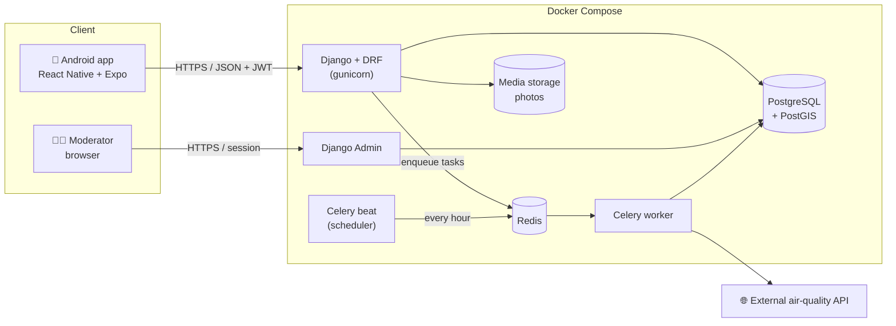
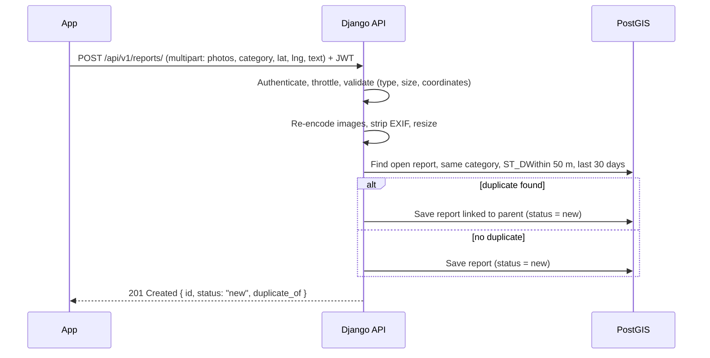

# 02 — Architecture

## 1. System overview



### Components

| Component | Responsibility |
|---|---|
| **Android app** | UI, camera, GPS, map. Holds no business rules — the API is the single source of truth. |
| **Django + DRF** | REST API, validation, permissions, business logic (services layer). |
| **Django Admin** | Moderation queue and data management. Same codebase, session auth, staff-only. |
| **PostgreSQL + PostGIS** | All data. PostGIS gives spatial types, spatial indexes and distance queries. |
| **Redis** | Message broker for Celery; later also cache for hot endpoints (latest AQI). |
| **Celery beat + worker** | Scheduled air-quality fetching; slow work (image processing) outside the request cycle. |
| **Media storage** | Local Docker volume in development; S3-compatible object storage in production. |

## 2. Key data flows

### 2.1 Creating a report



### 2.2 Moderator verifies a report

One **database transaction**: change status → write status-history row → write +10 ledger row. A unique constraint on `(report, reason)` in the ledger guarantees points are awarded **once**, even on a double click or a retried request (idempotency).

### 2.3 Air-quality ingestion

Celery beat enqueues `fetch_air_quality` every hour → worker calls the external API with a timeout and retries (exponential backoff) → stores new readings (skips ones already stored, using a unique `(station, measured_at)` constraint) → the app always reads from **our** database, never from the external API directly.

> Why not call the external API from the app? It would leak our API token, hit rate limits with many users, and break the app whenever the provider is down.

## 3. Backend structure

Organised by **domain** (Django apps), with a thin view layer and business logic in `services.py`:

```
backend/
├── config/                 # project settings, urls, celery app
│   └── settings/
│       ├── base.py
│       ├── dev.py
│       └── prod.py
├── apps/
│   ├── accounts/           # custom User, profile, JWT endpoints
│   ├── geo/                # Region, District (boundaries)
│   ├── air/                # Station, Reading, AQI categories, ingestion task
│   ├── reports/            # Category, Report, ReportPhoto, StatusHistory, duplicates
│   ├── points/             # PointTransaction ledger, leaderboards
│   └── common/             # shared base models, permissions, image utils
├── tests/
├── manage.py
├── requirements/
│   ├── base.txt
│   ├── dev.txt
│   └── prod.txt
└── Dockerfile
```

Inside each app:

| File | Contains |
|---|---|
| `models.py` | Data + constraints only |
| `services.py` | Business actions (`verify_report()`, `award_points()`) — transactional, testable without HTTP |
| `selectors.py` | Read queries (`reports_in_bbox()`, `leaderboard()`) |
| `serializers.py` | Input validation / output shape |
| `views.py` | HTTP glue: auth, permissions, call service, return response |
| `admin.py` | Moderation UI |
| `tasks.py` | Celery tasks |

> Why services? The same "verify report" action is triggered from Django Admin **and** possibly from the API later. Putting it in a service means one implementation, one set of tests.

## 4. Mobile structure

```
mobile/
├── app/                    # expo-router: file = screen
│   ├── (tabs)/
│   │   ├── index.tsx       # Map
│   │   ├── air.tsx         # Air quality
│   │   ├── report.tsx      # New report
│   │   └── profile.tsx     # Profile, my reports, points
│   ├── (auth)/
│   │   ├── login.tsx
│   │   └── register.tsx
│   └── _layout.tsx
├── src/
│   ├── api/                # HTTP client, endpoints, token refresh
│   ├── features/           # feature-specific hooks & components
│   ├── components/         # shared UI
│   ├── i18n/               # translations (uz first)
│   └── lib/                # secure storage, location helpers
└── app.json
```

- **Server state:** TanStack Query (caching, retries, refetch) — no Redux needed.
- **Tokens:** `expo-secure-store` (Android Keystore–backed), never AsyncStorage.

## 5. API conventions

- Base path `/api/v1/` — versioned so the app in users' phones doesn't break when the API evolves.
- JSON, `snake_case` fields, ISO 8601 UTC timestamps.
- Pagination: cursor-based for lists (stable under inserts).
- Errors: `{ "error": { "code": "validation_error", "message": "...", "fields": { ... } } }`.
- Coordinates: `lat`/`lng` in the API; stored as PostGIS `Point(lng, lat)` SRID 4326 (note the order!).

## 6. Authentication

| Client | Method | Why |
|---|---|---|
| Mobile app | JWT: access 15 min, refresh 7 days, **rotation + blacklist** | No cookies/CSRF on native; short access lifetime limits damage of a leaked token; blacklist enables real logout |
| Django Admin | Django session + CSRF | Built in, browser-based |

## 7. Technical decisions

| # | Decision | Alternatives considered | Reason |
|---|---|---|---|
| D1 | React Native + Expo | Kotlin, Flutter | Reuses React/JS skills; one codebase for Android now and iOS later; fast device testing via Expo Go |
| D2 | PostGIS (GeoDjango) | Plain lat/lng float columns | Real spatial indexes and `ST_DWithin` distance queries; bbox queries stay fast at scale |
| D3 | Django Admin for moderation | Separate React web panel | Saves weeks; moderators are few and internal |
| D4 | Append-only points ledger | Integer `points` column on User; blockchain | Auditable history, safe corrections, idempotent; no blockchain complexity |
| D5 | Duplicate detection by distance + category | AI image similarity | Simple, explainable, deterministic, no ML infrastructure |
| D6 | Celery + Redis for scheduling | cron + management command | Retries, backoff, observability; same tool for future async work |
| D7 | Business logic in services layer | Fat models / fat views | Reusable from API, admin and tasks; easy unit tests |
| D8 | Points only after moderation | Points on creation | Prevents point farming with fake or downloaded photos |

## 8. Security overview

Detailed in the security stage; the baseline:

- Object-level permissions on every view (owner checks → no IDOR).
- DRF throttling: login, register, report creation.
- Upload pipeline: content-type sniffing, size limit, Pillow re-encode, EXIF strip, random filenames (never user-supplied names).
- `DEBUG=False`, strict `ALLOWED_HOSTS`, HTTPS only, secure headers in production.
- Secrets via environment variables; `.env` never committed.
- Admin under a non-default URL, staff-only, strong passwords.

## 9. Deployment (target)

Single VPS with Docker Compose (api, worker, beat, db, redis) behind a reverse proxy with automatic HTTPS. Decided in detail in the deployment stage.
