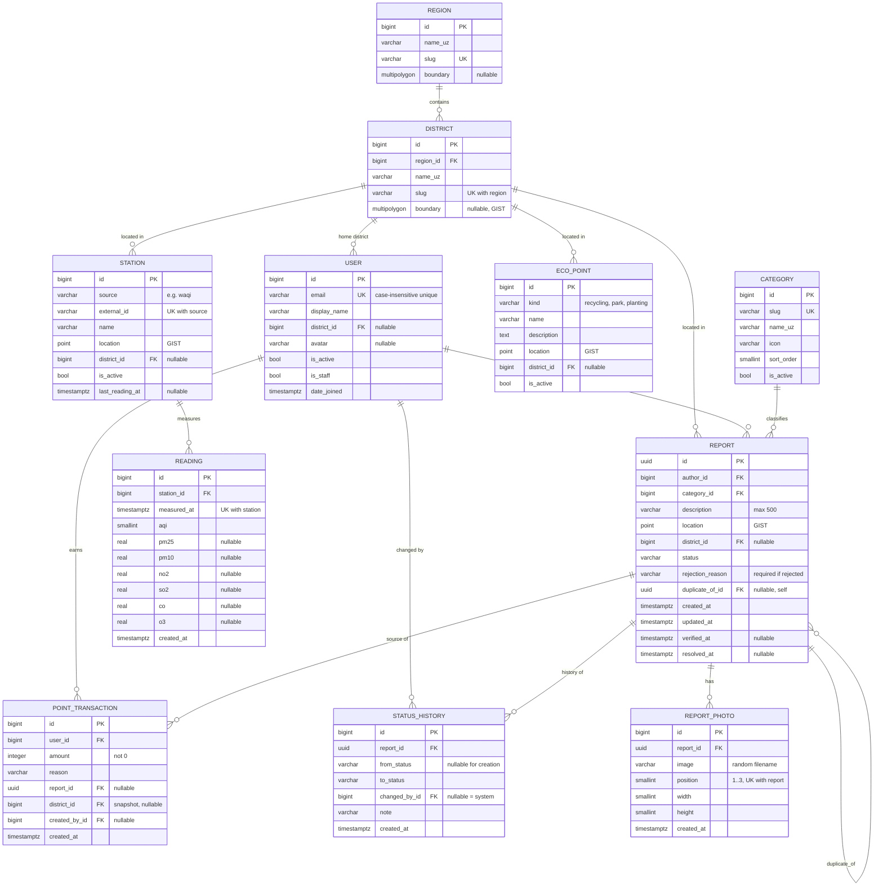

# 03 — Database Design

PostgreSQL 16 + PostGIS. All geometry is stored in **SRID 4326** (WGS 84 — the GPS standard). PostGIS points are `Point(lng, lat)` — **longitude first**.

## 1. ERD



## 2. Django apps → tables

| App | Models |
|---|---|
| `accounts` | `User` |
| `geo` | `Region`, `District`, `EcoPoint` |
| `air` | `Station`, `Reading` |
| `reports` | `Category`, `Report`, `ReportPhoto`, `StatusHistory` |
| `points` | `PointTransaction` |

## 3. Constraints (enforced by the database, not only by Python)

| Table | Constraint | Protects against |
|---|---|---|
| `User` | Unique `Lower(email)` | `Ali@mail.uz` and `ali@mail.uz` becoming two accounts |
| `District` | Unique `(region, slug)` | Duplicate districts |
| `Station` | Unique `(source, external_id)` | Importing the same station twice |
| `Reading` | Unique `(station, measured_at)` | Duplicate rows when the hourly task retries |
| `Reading` | Check `aqi BETWEEN 0 AND 999` | Garbage from the external API |
| `Report` | Check `status IN (...)` | Invalid statuses written by raw SQL or bugs |
| `Report` | Check `status <> 'rejected' OR rejection_reason <> ''` | Rejecting without a reason (FR-M2) |
| `Report` | Check `duplicate_of_id <> id` | A report being its own duplicate |
| `ReportPhoto` | Unique `(report, position)` + Check `position BETWEEN 1 AND 3` | More than 3 photos (FR-R1) |
| `PointTransaction` | Check `amount <> 0` | Meaningless rows |
| `PointTransaction` | **Partial unique** `(report, reason) WHERE report IS NOT NULL` | Awarding points for the same report twice (FR-P1 idempotency) |

## 4. Indexes

| Index | Type | Serves |
|---|---|---|
| `Report.location` | **GiST** | Map bbox query (FR-R2), duplicate search within 50 m (FR-R5) |
| `Report (status, created_at)` | B-tree | Moderation queue: `WHERE status='new' ORDER BY created_at` (FR-M1) |
| `Report (author, created_at)` | B-tree | "My reports" (FR-R4) |
| `Reading (station, measured_at DESC)` | B-tree (from the unique constraint) | Latest reading + 24 h / 7 d history (FR-AQ2, FR-AQ4) |
| `Station.location`, `EcoPoint.location` | GiST | Nearest station (FR-AQ3), map layers |
| `District.boundary` | GiST | "Which district is this point in?" (`ST_Contains`) |
| `PointTransaction (user)` | B-tree | User balance (FR-P3) |
| `PointTransaction (created_at)` | B-tree | Monthly leaderboard (FR-P4) |

Foreign keys get B-tree indexes automatically in Django.

## 5. Deletion rules (`on_delete`)

| Relation | Rule | Why |
|---|---|---|
| `Report.author → User` | `PROTECT` | Users are **deactivated** (`is_active=False`), never deleted, so the history stays intact |
| `Report.category → Category` | `PROTECT` | Categories are deactivated, not deleted |
| `ReportPhoto / StatusHistory → Report` | `CASCADE` | They don't exist without their report |
| `PointTransaction → User / Report` | `PROTECT` | The ledger must never lose rows |
| `Report.duplicate_of → Report` | `SET_NULL` | Removing the parent should not delete the children |
| `* → District` | `SET_NULL` | Reference data may be reorganised |
| `Reading → Station` | `CASCADE` | Readings are meaningless without their station |

## 6. Design decisions

| # | Decision | Reason |
|---|---|---|
| DB1 | **Custom `User` model from the first migration**, login by email | Changing the user model after the first migration is very painful in Django |
| DB2 | **UUID** primary key for `Report`; bigint elsewhere | Report IDs appear in public URLs; UUIDs don't reveal how many reports exist and can't be guessed sequentially. *This is defence in depth — permission checks are still the real protection against IDOR.* |
| DB3 | **AQI category is not stored** | It is derived from `aqi` by a pure function. Storing derived data creates two sources of truth that can disagree |
| DB4 | **Balance is not stored**, it's `SUM(amount)` | One source of truth: the ledger. If it gets slow (unlikely below ~1M rows with an index), add a cached column updated in the same transaction |
| DB5 | `PointTransaction.district` is a **snapshot** | If a user moves to another district, their past points must keep counting for the old one. History must not change retroactively |
| DB6 | `Report.district` is filled automatically with `ST_Contains(district.boundary, report.location)` | Users don't choose it, so it can't be wrong. Nullable until boundaries are loaded |
| DB7 | Status stored as `varchar` + check constraint (Django `TextChoices`) | Readable in SQL and admin; adding a status is a simple migration, unlike PostgreSQL `ENUM` |
| DB8 | `timestamptz` everywhere (`USE_TZ = True`), stored in UTC | Converted to Asia/Tashkent only for display |
| DB9 | Readings retention: keep raw hourly data 1 year (decided later) | ~10 stations × 24 × 365 ≈ 88k rows/year — tiny; no partitioning needed for the MVP |

## 7. Example queries the design must support

```sql
-- Map: reports in the visible area (FR-R2)
SELECT id, category_id, status, location
FROM reports_report
WHERE status IN ('verified', 'in_progress', 'resolved')
  AND location && ST_MakeEnvelope(:min_lng, :min_lat, :max_lng, :max_lat, 4326);

-- Duplicate check within 50 m (FR-R5) — geography cast gives metres
SELECT id FROM reports_report
WHERE category_id = :category
  AND status IN ('new', 'verified', 'in_progress')
  AND duplicate_of_id IS NULL
  AND created_at > now() - interval '30 days'
  AND ST_DWithin(location::geography, ST_SetSRID(ST_MakePoint(:lng, :lat), 4326)::geography, 50)
ORDER BY created_at
LIMIT 1;

-- Monthly district leaderboard (FR-P4)
SELECT district_id, SUM(amount) AS points
FROM points_pointtransaction
WHERE created_at >= date_trunc('month', now())
GROUP BY district_id
ORDER BY points DESC
LIMIT 10;
```

> In Django these become ORM queries (`location__bboverlaps`, `location__dwithin`, `annotate(Sum(...))`) — the SQL is here so you understand what the ORM generates.
